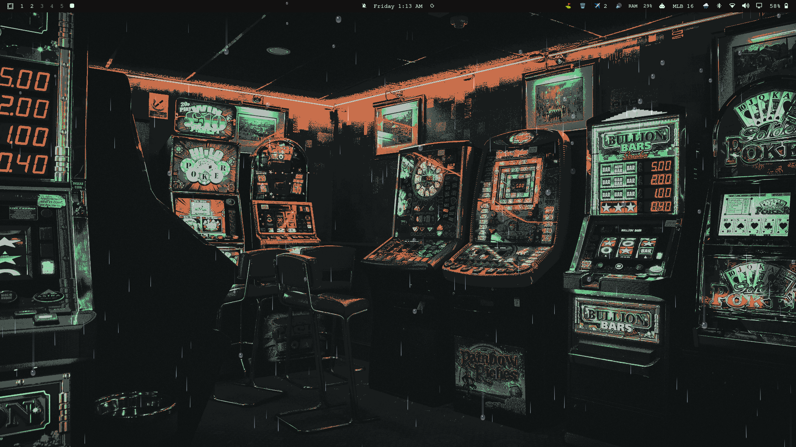

# Pane

Weather on the inside of your screen.

Pane draws rain, snow and storms on a transparent, click-through layer over
your desktop. Streaks fall across your windows. Droplets bead up on the glass,
merge when they touch, and run down in rivulets that pick up whatever they pass
on the way. Fog creeps in from the edges of the screen. A thunderstorm throws a
forked bolt across everything, and the flash falls brighter on the side it
struck.

When the weather stops, the pane dries off rather than blinking out — the
remaining beads shrink and evaporate over a minute or so, and only then does
the surface go away.

Every click, drag and hover passes straight through it. You can work normally
with a downpour running.



## Install

```
omarchy plugin add https://github.com/Bert0424/omarchy-pane.git
omarchy plugin enable bert.pane
```

Then add the **Pane** widget to your bar from the bar settings. Left-click the
pill for the tuning popup; middle-click toggles the weather off and on.

## Remove

```
omarchy plugin disable bert.pane
omarchy plugin remove bert.pane
```

Nothing is left behind — see *What it does to your system* below.

## Settings

| Setting | What it does |
| --- | --- |
| **Show weather** | Master on/off. When off, the overlay surface is destroyed, not hidden. |
| **Conditions** | Drizzle, Rain, Downpour, Thunderstorm, Snow. |
| **Density** | Sparse / Normal / Heavy multiplier. |
| **Wind** | None (straight down, the default), Light, Gusty. |
| **Layer** | On the desktop, in front of windows, or above everything. |
| **Falling rain** | The streaks crossing the screen. |
| **Droplets on the glass** | Beads that cling, merge with each other, then run down leaving a trail. |
| **Fog** | Haze creeping in from the screen edges. The middle stays clear so text keeps its contrast. |
| **Lightning** | Thunderstorm only. |
| **Pause over fullscreen windows** | Stops completely for games and video. |

Conditions are currently chosen by hand. Live weather from your actual location
is planned but not implemented — Pane does not touch the network today.

## Performance

The effect is real rendering, so it is not free. Measured on an 11th-gen Intel
iGPU at 1920x1080, as **added** share of one core over the shell's own idle —
added rather than absolute, because the shell's baseline depends on how many
other plugins you run, and yours will differ from mine:

| State | Added cost |
| --- | --- |
| Off (surface destroyed) | none measurable |
| Drizzle / Normal | ~6% |
| Rain / Normal | ~9% |
| Downpour / Normal | ~10% |
| Rain / Normal + fog | ~11% |
| Thunderstorm / Heavy | ~13% |
| Thunderstorm / Heavy + fog | ~15% |

Fog costs roughly two points on top of whatever is falling. Beads merging costs
nothing measurable: the pool is a fixed size, so finding contacts is a few
hundred comparisons every 220ms no matter how hard it rains.

Switched off, Pane measured 0.3 points above having the plugin disabled
outright, which is inside the noise. That is the design working: when there is
no weather the layer-shell surface is unmapped entirely rather than hidden, so
being switched off genuinely costs nothing. The dry-off runs first, then the
surface goes and stays gone. And with *Pause over fullscreen windows* on, the
surface is destroyed whenever a window goes fullscreen, so games and video are
untouched.

Treat all of these as approximate. They move by a point or two depending on
what else is on screen.

## What it does to your system

Deliberately very little:

- **Files written:** none. Your settings live in the Omarchy shell's own
  `shell.json` through the standard bar-widget mechanism, exactly like every
  first-party widget. Pane itself writes nothing to disk.
- **Network:** none. No requests, no telemetry, no analytics, no accounts.
- **Commands run:** none. Pane starts no subprocesses.
- **Privileges:** none. It runs entirely as your user inside the shell process
  and needs no elevated permissions of any kind.
- **Reads:** one thing — Hyprland's event socket
  (`$XDG_RUNTIME_DIR/hypr/$HYPRLAND_INSTANCE_SIGNATURE/.socket2.sock`),
  read-only, purely to notice when a window enters or leaves fullscreen so the
  effect can pause. Only lines beginning with `fullscreen>>` are parsed and
  everything else is ignored. Turn *Pause over fullscreen windows* off and the
  socket is never opened.
- **Draws:** one transparent layer-shell surface per screen, in the
  `bert-pane` namespace, with an empty input region so it can never intercept
  input.

Removing the plugin removes all of it; there is no daemon, no state file and no
external resource to clean up.

## Limitations

The droplets do not refract what is behind them. A Wayland layer surface has no
read access to the composited framebuffer beneath it, so true glass distortion
is not possible without screen capture, which Pane deliberately does not do.
The beads are painted with rim light, a specular highlight and a trail instead,
which reads convincingly.

## Requirements

Omarchy's Quickshell-based shell, on Hyprland.

## License

MIT — see [LICENSE](LICENSE).
